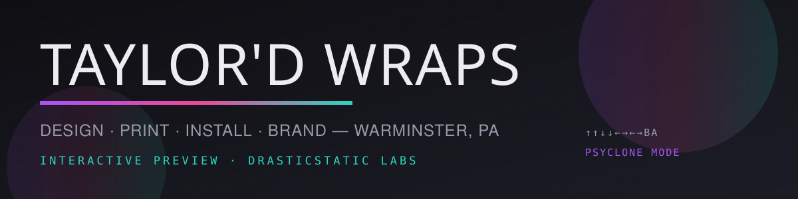

# TAYLOR'D WRAPS — INTERACTIVE SHOWCASE

> **A wrap shop's website that transforms itself.** The Peel, the wrap-anything Visualizer, the Vinyl Toolbox, the bilingual Arrival Kit, the printable Work Order, and a Time Machine that keeps every era of the build visitable.

**Live preview:** https://drasticstatic.github.io/taylordwraps-public-preview/
**Next era (Next.js):** https://drasticstatic.github.io/taylordwraps-nextjs-preview/
**Private source:** `drasticstatic/taylordwraps` (this repo)

---

## WHAT'S INSIDE (v1.6)

| Feature | What it does |
| --- | --- |
| **The Peel** | The hero van wraps itself on load; drag to replay the transformation, peel it back to bare metal. |
| **The Visualizer** | 10 bodies (work van, coupe, mower, tool chest, RC truck fresh shell, mom's RC original, ATV, jet ski, snowmobile, skate + snow decks) × films × finishes. The film lands **on the paint**, not the backdrop — a canvas color-blend engine masks white/neutral shells so creases and shadows survive the wrap. Uploaded photos get an honest hue-wash disclaimer instead of fake precision. |
| **The Vinyl Toolbox** | Squeegee (double-click = full windshield-wiper sweep), eraser, blade, heat gun, film swatches, undo/clear. Tools become your cursor until you hover a control. On phones it collapses into a floating tool button. |
| **The Arrival Kit** | Bilingual welcome (EN/ES language doors, honesty line, translation-in-review mark) modeled on "a welcome in your language." |
| **The Work Order** | Four steps to a numbered spec that emails the shop. No checkout anywhere — the site ends in a phone call. |
| **The Time Machine** | Standalone `time-machine.html`; opens from the settings drawer, not the page edge. Every era visitable. |
| **Proposal Sheet** | `proposal.html` — printable raspberry-branded quote/proposal generator for the counter. |
| **Custom 404** | `404.html` — "this panel isn't wrapped yet," linked intentionally from the nav (`LOST?`). |
| **CTA Peel** | Primary buttons carry a vinyl peel corner that breathes while hovered and reveals a hidden message. |

## PRINCIPLES

- **Static, always.** GitHub-hosted pages take no payments and run no storefront; commerce stays on the shop's own portal.
- **Taylor is the owner and approver.** This is a drasticstatic labs showcase until she says otherwise — no implied endorsement, no invented shop claims.
- **Honest imagery.** Placeholder visuals are marked; mom's RC truck photo is used with permission.
- **Playful, but reachable.** Easter eggs stay discoverable without hiding anything essential behind keyboard tricks.

## THE ERAS

| Era | Where |
| --- | --- |
| v1.6 (current) | this build |
| v1.2 / v1 archived | `archive/` in the deploy |
| Next.js era | [taylordwraps-nextjs-preview](https://github.com/drasticstatic/taylordwraps-nextjs-preview) |

## BUILD

Sources are split (`src_head.html`, `src_body.html`, `src_script.html`); `build_repo.py` emits the multi-file site into `repo/`, `build_mono.py` emits a single-file bundle with assets inlined. `.bootstrap/bundle.json` in each GitHub lane points at a verified zip (SHA-256 checked) that the sync workflow unpacks.

---

Handcrafted in [drasticstatic labs](https://drasticstatic.github.io/) with [Littlebird](https://littlebird.ai) · code MIT · content CC BY-SA 4.0 · names/marks: `TRADEMARKS.md` · © 2026 Taylor'd Wraps
